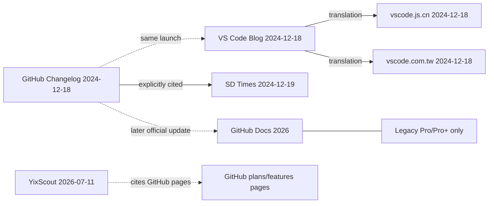

# C-01 · GitHub Copilot Free 50 chat requests 说法来源关系

> 材料状态：待人工核实 · 系统状态：未运行 · 复核状态：未复核
>
> 本文件记录真实来源、原文、翻译、引用关系和证据缺口，不记录人工参考答案。参考判断在 `reference.md`，独立复核在 `review.md`。
>
> **当前不是人工金标准。** 所有结论待实际核查者确认；系统提供方未接入，未提交调查，无调查 ID 或快照 ID。

## 1. 案例标识

| 字段 | 值 | 说明 |
|---|---|---|
| 案例 ID | C-01 | 与目录、索引一致 |
| 类型 | C | 来源关系、转载与证据不足 |
| 当前组织 | 乙丙 | 材料、关系、交付完整性；历史owner原值保留 |
| 创建／更新时间 | 2026-10-24T22:47:37+08:00 / 2026-10-24T22:52:18+08:00 | Asia/Shanghai |
| 材料状态 | 待人工核实 | 已有真实材料与参考草稿；未经实际核查者确认 |
| 系统状态 | 未运行 | 正式提供方未接入，见 §12 |
| 复核状态 | 未复核 | 实际独立复核尚未完成 |

## 2. 问题与意图

### 2.1 用户问题原话

> 关于 GitHub Copilot Free 每月包含 2,000 次代码补全和 50 次 chat requests 的几条说法，哪些是独立来源，哪些只是同一作者或同一文章的转载？

- 问题来源／获取时间：用户本轮指定 C 类模板 + 产品/功能，2026-10-24T22:40:00+08:00
- 是否包含多个问题：是；拆为 §5 的 Q1–Q6
- 回答意图：客观搜查

### 2.2 系统提交问题

| 字段 | 值 |
|---|---|
| 提交问题（API `question`） | `关于 GitHub Copilot Free 每月包含 2,000 次代码补全和 50 次 chat requests 的几条说法，哪些是独立来源，哪些只是同一作者或同一文章的转载？` |
| SHA-256（UTF-8 字节） | `a00babf0802eba93d6957cfbd35ec3e3eb99157812df749dc69042e0d411b99d` |
| 是否与 2.1 一致 | 是 |

## 3. 产品身份

| 字段 | 值 | 说明 |
|---|---|---|
| 产品名 | GitHub Copilot | 本节具体到 Copilot Free 套餐 |
| 官方站点 | https://github.com/features/copilot；https://docs.github.com/copilot | GitHub 官方产品与文档 |
| 版本 | `null` | 套餐不是版本号；2024-12-18 发布，2026 当前文档 |
| 套餐 | Copilot Free | 与 Copilot Pro／Business 分开 |
| 地区 | `null` | 本轮不核地区；官方页面未强调地区限制 |
| 账号类型 | 个人 GitHub 账号 | Free 套餐面向个人开发者 |
| 身份状态 | CONFIRMED | 官方公告、VS Code 公告与 GitHub Docs 可定位 |
| 歧义／消歧说明 | 只讨论 Copilot Free 的“2,000 completions + 50 chat requests”说法，不讨论 Pro 的 premium requests | 见 §3.1 |

### 3.1 身份依据

| # | URL | 原句（≤300） | 获取时间 | 确认理由 |
|---|---|---|---|---|
| I1 | https://github.blog/changelog/2024-12-18-announcing-github-copilot-free/ | Announcing GitHub Copilot Free | 2026-10-24T22:46:28+08:00 | GitHub 官方 changelog 命名 Copilot Free |
| I2 | https://code.visualstudio.com/blogs/2024/12/18/free-github-copilot | Announcing a free GitHub Copilot for VS Code | 2026-10-24T22:46:30+08:00 | VS Code 官方博客同日发布免费方案 |
| I3 | https://docs.github.com/en/copilot/get-started/plans | Limited to 2000 completions per month on Copilot Free. | 2026-10-24T22:46:37+08:00 | 当前官方文档确认 Copilot Free 仍存在 |

## 4. 时间与适用

| 字段 | 值 | 说明 |
|---|---|---|
| 研究开始 | 2026-10-24T22:40:00+08:00 | 本次检索开始 |
| 研究结束 | 2026-10-24T22:47:37+08:00 | 本次检索结束 |
| 事实基准日 | 2026-10-24 | 结论依据材料截止到该日 |
| 事实适用起 | 2024-12-18 | 2024 公告的发布日期 |
| 事实适用止 | `null` | 2024 说法之后何时改变未确定；当前文档已改为 AI credits |
| 适用依据 | 2024 公告、VS Code 公告、2026 当前文档 | 见 §7 |
| 时区 | Asia/Shanghai（显示） | 存储用含偏移 ISO 8601 |

> 时间线：2024-12-18 GitHub/VS Code 公告 2,000 completions + 50 chat；2024-12-19 SD Times 引用；2026-07-11 YixScout 仍重复 50；2026-10-24 GitHub Docs 只明确 2,000 completions + AI credits，没有固定 50。不能把 2024 的说法直接当成 2026 当前事实。

## 5. 核查范围与原子问题

### 5.1 范围

- 在范围内：Copilot Free 的 2,000 code completions 与 50 chat requests/messages 说法；2024-12-18 官方公告；2024-12 媒体/翻译；2026 二手文章；2026 当前 GitHub Docs。
- 不在范围内：Pro 的 premium requests；实际账户使用测试（未登录/未绕过任何限制）；所有 Copilot 功能；不同地区的可用性。
- 回答意图：客观搜查。

### 5.2 原子问题

| Q-ID | 原子问题 | 关联主张 | 判断标准／需要的证据 |
|---|---|---|---|
| Q1 | 待核查的说法逐条原文是什么？最早出处是谁？ | C1、C2、C3、C4、C5 | 每条有原文、作者、时间、定位 |
| Q2 | 每条说法的直达 URL、作者、发布时间、定位是什么？ | C3、C4、C5、C6 | 直接引用/翻译/改写关系可定位 |
| Q3 | 哪些是同一作者、同一文章、同一 upstream？ | C3、C4、C5、C8 | 同一文章/翻译/引用链 |
| Q4 | 哪些可以判为独立？依据是什么？ | C8、C10、C12、C13 | 独立第一手证据，不是转载 |
| Q5 | 是否存在一手来源？转载是否改变原意/增加结论？ | C1、C2、C3、C4、C5、C11 | 原文 vs 译文/改写对比 |
| Q6 | 扣除重复来源后，证据能支持什么，缺什么？ | C6、C7、C8、C9、C10、C12 | 独立来源计数 + 当前官方基线 |

### 5.3 类型特有门槛

- C：至少三条可定位说法；至少一组同源关系；独立来源按源头计；一手来源已尝试定位。本案例有 9 个 URL、6 个 50 说法页面、1 个官方源头组；独立第一手 0。

## 6. 检索记录

| R-ID | 提供方 | 查询词／目标 | 调用时间 | 状态 | 错误 | 返回来源／采用情况 |
|---|---|---|---|---|---|---|
| R1 | 手工网页搜索（非系统提供方） | "Copilot Free" "50 chat" requests per month 2024 GitHub announcement | 2026-10-24T22:40+08:00 | SUCCEEDED | null | 定位 GitHub Changelog、VS Code Blog、SD Times、中文翻译、YixScout、当前 Docs |
| R2 | 直接抓取（curl） | https://github.blog/changelog/2024-12-18-announcing-github-copilot-free/ | 2026-10-24T22:46:28+08:00 | SUCCEEDED | null | E1、I1；官方原始 |
| R3 | 直接抓取（curl） | https://code.visualstudio.com/blogs/2024/12/18/free-github-copilot | 2026-10-24T22:46:30+08:00 | SUCCEEDED | null | E2–E3、I2；官方同日公告 |
| R4 | 直接抓取（curl） | https://sdtimes.com/ai/github-copilot-free-launches-to-expand-reach-of-platform-to-all-developers/ | 2026-10-24T22:46:32+08:00 | SUCCEEDED | null | E4–E5；引用 GitHub |
| R5 | 直接抓取（curl） | https://vscode.js.cn/blogs/2024/12/18/free-github-copilot | 2026-10-24T22:46:34+08:00 | SUCCEEDED | null | E6–E7；简体中文翻译 |
| R6 | 直接抓取（curl） | https://vscode.com.tw/blogs/2024/12/18/free-github-copilot | 2026-10-24T22:46:35+08:00 | SUCCEEDED | null | E8–E9；繁体中文翻译 |
| R7 | 直接抓取（curl） | https://yixscout.com/zh/resources/columns/github-copilot-pricing-free | 2026-10-24T22:46:36+08:00 | SUCCEEDED | null | E10–E11；2026 二手 |
| R8 | 直接抓取（curl） | https://docs.github.com/en/copilot/get-started/plans | 2026-10-24T22:46:37+08:00 | SUCCEEDED | null | E12–E13；当前官方 |
| R9 | 直接抓取（curl） | https://docs.github.com/en/copilot/concepts/billing-and-usage/individuals/billing | 2026-10-24T22:46:38+08:00 | SUCCEEDED | null | E14–E15；当前官方 |
| R10 | 直接抓取（curl） | https://docs.github.com/en/copilot/reference/copilot-billing/request-based-billing-legacy/copilot-requests | 2026-10-24T22:46:39+08:00 | SUCCEEDED | null | E16；当前官方 legacy 范围 |
| R11 | 直接抓取（curl） | https://www.c114.com.cn/ai/5339/a1280355.html | 2026-10-24T22:46:40+08:00 | FAILED | HTTP 403 | 未能读取；保留为未核实线索，不计入证据 |

> 本次是 D1 人工核查，不是系统提供方检索；未使用元宝，也不把网页搜索当成系统运行。只访问公开页面，未绕过登录、付费墙或反爬。C114/IT之家 403 已如实记录，不补造原文。原始 HTML 保存在忽略的 `.cache/d1/c-01/raw/`，不纳入交付；证据以 URL、原句、定位和 hash 为准。

## 7. 证据

### 7.1 来源与元数据

| E-ID | URL（直达） | 标题／站点 | 作者／公开账号 | 发布时间 | 获取时间 | 语言 | sourceType | contentKind | 版本／套餐 | readStatus | readError |
|---|---|---|---|---|---|---|---|---|---|---|---|
| E1 | https://github.blog/changelog/2024-12-18-announcing-github-copilot-free/ | Announcing GitHub Copilot Free／github.blog | GitHub | 2024-12-18T00:00:00Z | 2026-10-24T22:46:28+08:00 | en | OFFICIAL | OFFICIAL_CLAIM | 2024-12-18 launch／Copilot Free | READ | null |
| E2 | https://code.visualstudio.com/blogs/2024/12/18/free-github-copilot | Announcing a free GitHub Copilot for VS Code／code.visualstudio.com | Burke Holland | 2024-12-18T00:00:00Z | 2026-10-24T22:46:30+08:00 | en | OFFICIAL | OFFICIAL_CLAIM | 2024-12-18 launch／Copilot Free | READ | null |
| E3 | https://code.visualstudio.com/blogs/2024/12/18/free-github-copilot | 同上 | Burke Holland | 2024-12-18T00:00:00Z | 2026-10-24T22:46:30+08:00 | en | OFFICIAL | OFFICIAL_CLAIM | 2024-12-18 launch／Copilot Free | READ | null |
| E4 | https://sdtimes.com/ai/github-copilot-free-launches-to-expand-reach-of-platform-to-all-developers/ | GitHub Copilot Free launches to expand reach of platform to all developers／SD Times | Jenna Barron | 2024-12-19T15:43:49Z | 2026-10-24T22:46:32+08:00 | en | THIRD_PARTY | FACT | 2024-12-19 report／Copilot Free | READ | null |
| E5 | https://sdtimes.com/ai/github-copilot-free-launches-to-expand-reach-of-platform-to-all-developers/ | 同上 | Jenna Barron | 2024-12-19T15:43:49Z | 2026-10-24T22:46:32+08:00 | en | THIRD_PARTY | FACT | 2024-12-19 report／Copilot Free | READ | null |
| E6 | https://vscode.js.cn/blogs/2024/12/18/free-github-copilot | 宣布面向 VS Code 的免费版 GitHub Copilot／vscode.js.cn | Burke Holland（译者未署名） | 2024-12-18T00:00:00Z | 2026-10-24T22:46:34+08:00 | zh-CN | THIRD_PARTY | FACT | 中文翻译／Copilot Free | READ | null |
| E7 | https://vscode.js.cn/blogs/2024/12/18/free-github-copilot | 同上 | Burke Holland（译者未署名） | 2024-12-18T00:00:00Z | 2026-10-24T22:46:34+08:00 | zh-CN | THIRD_PARTY | FACT | 中文翻译／Copilot Free | READ | null |
| E8 | https://vscode.com.tw/blogs/2024/12/18/free-github-copilot | 宣布推出適用於 VS Code 的免費 GitHub Copilot／vscode.com.tw | Burke Holland（譯者未署名） | 2024-12-18T00:00:00Z | 2026-10-24T22:46:35+08:00 | zh-TW | THIRD_PARTY | FACT | 中文翻譯／Copilot Free | READ | null |
| E9 | https://vscode.com.tw/blogs/2024/12/18/free-github-copilot | 同上 | Burke Holland（譯者未署名） | 2024-12-18T00:00:00Z | 2026-10-24T22:46:35+08:00 | zh-TW | THIRD_PARTY | FACT | 中文翻譯／Copilot Free | READ | null |
| E10 | https://yixscout.com/zh/resources/columns/github-copilot-pricing-free | GitHub Copilot 价格 2026：免费版到底含什么、$10 的 Pro，以及新出的 Max 档／YixScout | YixScout 编辑团队 | 2026-07-11T00:00:00Z | 2026-10-24T22:46:36+08:00 | zh-CN | THIRD_PARTY | FACT | 2026-07-11 文章／Copilot Free | READ | null |
| E11 | https://yixscout.com/zh/resources/columns/github-copilot-pricing-free | 同上 | YixScout 编辑团队 | 2026-07-11T00:00:00Z | 2026-10-24T22:46:36+08:00 | zh-CN | THIRD_PARTY | FACT | 2026-07-11 文章／Copilot Free | READ | null |
| E12 | https://docs.github.com/en/copilot/get-started/plans | Plans for GitHub Copilot／docs.github.com | GitHub | null | 2026-10-24T22:46:37+08:00 | en | OFFICIAL | FACT | current 2026 docs／Copilot Free | READ | null |
| E13 | https://docs.github.com/en/copilot/get-started/plans | 同上 | GitHub | null | 2026-10-24T22:46:37+08:00 | en | OFFICIAL | FACT | current 2026 docs／Copilot Free | READ | null |
| E14 | https://docs.github.com/en/copilot/concepts/billing-and-usage/individuals/billing | Usage-based billing for individuals／docs.github.com | GitHub | null | 2026-10-24T22:46:38+08:00 | en | OFFICIAL | FACT | current 2026 docs／Copilot Free | READ | null |
| E15 | https://docs.github.com/en/copilot/concepts/billing-and-usage/individuals/billing | 同上 | GitHub | null | 2026-10-24T22:46:38+08:00 | en | OFFICIAL | FACT | current 2026 docs／Copilot Free | READ | null |
| E16 | https://docs.github.com/en/copilot/reference/copilot-billing/request-based-billing-legacy/copilot-requests | Requests in GitHub Copilot (legacy)／docs.github.com | GitHub | null | 2026-10-24T22:46:39+08:00 | en | OFFICIAL | FACT | legacy docs／Pro/Pro+ only | READ | null |

### 7.2 原文、译文与定位

| E-ID | originalExcerpt（原文，≤300） | translation（译文，非原话） | originalLocation（kind／locator／context） | contentHash（SHA-256） |
|---|---|---|---|---|
| E1 | you will have access to 2000 Code Completions and 50 chat messages per month! | 你每月将获得 2,000 次代码补全和 50 次聊天消息。 | TEXT／GitHub Changelog > 正文第一段／官方 2024 原始公告 | 03af67c277d6e7caeb24d74288321a73ac3e71b223fd6c12c8e53108d22cb237 |
| E2 | With GitHub Copilot Free you get 2000 code completions/month | 使用 GitHub Copilot Free，你每月获得 2000 次代码补全。 | TEXT／VS Code Blog > 开头第 3 段／官方同日公告 | 7bbcf5e35e4751d2a12f2eb71e4714b319ef4b8a8d4e1eff19e5842b8b3c0a7a |
| E3 | You also get 50 chat requests/month | 你还每月获得 50 次聊天请求。 | TEXT／VS Code Blog > 同一段／官方同日公告 | 7bbcf5e35e4751d2a12f2eb71e4714b319ef4b8a8d4e1eff19e5842b8b3c0a7a |
| E4 | The free tier provides access to 2,000 code completions and 50 chat messages per month. | 免费层每月提供 2,000 次代码补全和 50 次聊天消息。 | TEXT／SD Times > 第 3 段／二次报道 | 7f67d0c51fb96c66b2aac39a9a7a5c96e3d90838b247e63f29a442130c500992 |
| E5 | Thomas Dohmke, CEO of GitHub, wrote in a post | GitHub CEO Thomas Dohmke 在一篇文章中写道。 | TEXT／SD Times > 第 2 段／"post" 链接指向 GitHub 官方公告 | 7f67d0c51fb96c66b2aac39a9a7a5c96e3d90838b247e63f29a442130c500992 |
| E6 | 通过 GitHub Copilot 免费版，你每月可获得 2000 次代码补全 | null（中文译文；英文原文见 E2） | TEXT／vscode.js.cn > 开头第 4 段／VS Code 博客简体中文翻译 | 3ce79de4e860a69e70106ef2784368bbe4541a49731081ea0f82d2404ad19c9f |
| E7 | 你还可以每月获得 50 次聊天请求 | null（中文译文；英文原文见 E3） | TEXT／vscode.js.cn > 同一段／VS Code 博客简体中文翻译 | 3ce79de4e860a69e70106ef2784368bbe4541a49731081ea0f82d2404ad19c9f |
| E8 | 你每月可享有 2,000 次程式碼自動完成（code completions） | null（中文譯文；英文原文見 E2） | TEXT／vscode.com.tw > 開頭第 4 段／VS Code 部落格繁體中文翻譯 | 37497ae3f7c2c5d2c246ca9eedb971a4cfb8614ff3175186bd161fac1769d9e6 |
| E9 | 每月 50 次聊天請求 | null（中文譯文；英文原文見 E3） | TEXT／vscode.com.tw > 同一段／VS Code 部落格繁體中文翻譯 | 37497ae3f7c2c5d2c246ca9eedb971a4cfb8614ff3175186bd161fac1769d9e6 |
| E10 | $0 拿到每月 2,000 次补全、50 次聊天请求（含 Copilot Edits） | null（中文原文） | TEXT／YixScout > 开头摘要／2026-07-11 二手文章，附加 "含 Copilot Edits" | 4320909ab9aa8fb7354eebb9eb2a498981d79177a2d181440a7494a9a9ea1453 |
| E11 | 本段每个数字都于 2026-07-11 对照 GitHub 官方定价页核验。 | null（中文原文） | TEXT／YixScout > 开头摘要后／声称已核验，但未给页面快照 | 4320909ab9aa8fb7354eebb9eb2a498981d79177a2d181440a7494a9a9ea1453 |
| E12 | Limited to 2000 completions per month on Copilot Free. | Copilot Free 每月最多 2000 次补全。 | TEXT／GitHub Docs "Plans" > "Inline suggestions and Copilot Chat" > bullet／当前官方 | cb6109e259062cda3215ef47114b6a4d1704c9314e59e6b952f40160a7359a23 |
| E13 | Copilot Free and Copilot Student both have an allowance of AI credits. | Copilot Free 和 Copilot Student 都有 AI credits 额度。 | TEXT／同一页 > "GitHub AI Credits allowance by plan" > 段落／当前官方；未列固定 50 | cb6109e259062cda3215ef47114b6a4d1704c9314e59e6b952f40160a7359a23 |
| E14 | All individual plans—Copilot Free, Copilot Pro, Copilot Pro+, and Copilot Max—include a monthly GitHub AI Credits allowance that varies by plan. | 所有个人计划——Copilot Free、Pro、Pro+、Max——都包含每月 GitHub AI Credits 额度，额度随计划而异。 | TEXT／GitHub Docs "Usage-based billing" > "How do AI credits work?" > 第一段／当前官方 | 82731d546cf898308e7cf83c7e376d41f729ee20adf9c685cfbc4d11416af454 |
| E15 | Copilot Free includes 2000 code completions per month | Copilot Free 包含每月 2000 次代码补全 | TEXT／同一页 > "How do AI credits work?" > 段落／当前官方 | 82731d546cf898308e7cf83c7e376d41f729ee20adf9c685cfbc4d11416af454 |
| E16 | This article only applies to Copilot Pro and Copilot Pro+ subscribers on an existing annual plan who remained on legacy premium request-based billing after June 1, 2026. | 本文仅适用于在 2026 年 6 月 1 日后仍保留旧版 premium request 计费的 Copilot Pro 和 Pro+ 年度计划订阅者。 | TEXT／Legacy Requests > 顶部 IMPORTANT／当前官方；不适用于 Copilot Free | c5599178aa7c51501f7c320349893ee0bc1c8a4481ec818a3b4ad3aa284d5593 |

> 原句逐字符摘录。E6–E9 是中文翻译/镜像，`translation` 留空并注明英文原文；E10/E11 是中文二手文章。所有 READ 证据都有定位和 SHA-256；hash 针对 2026-10-24 抓取的原始 HTML。

### 7.3 同源与独立性

| E-ID | upstreamUrl | independence | originGroupId | independenceReason |
|---|---|---|---|---|
| E1–E3 | null | SHARED_ORIGIN | github-official-launch | GitHub Changelog 与 VS Code Blog 是同一发布方、同一天、同一发布事件；不能当两个独立来源 |
| E4–E5 | https://github.blog/news-insights/product-news/github-copilot-in-vscode-free/ | SHARED_ORIGIN | github-official-launch | SD Times 明确引用 GitHub CEO 的 post；二次改写 |
| E6–E9 | https://code.visualstudio.com/blogs/2024/12/18/free-github-copilot | SHARED_ORIGIN | vscode-blog-translations | 同标题、同作者、同日期、同段落结构的简体/繁体中文翻译；不是独立来源 |
| E10–E11 | null | UNKNOWN | null | 声称 2026-07-11 对照 GitHub 官方定价页，但未给页面快照；无法确认当时页面；不计独立来源 |
| E12–E16 | null | SHARED_ORIGIN | github-official-current | 同一发布方 GitHub 的当前文档；官方基线，不是独立第三方 |

### 7.4 独立性汇总

| 项 | 值 | 说明 |
|---|---|---|
| URL 总数 | 9 | GitHub Changelog、VS Code Blog、SD Times、js.cn、com.tw、YixScout、GitHub Plans、Billing、Legacy |
| “50 chat”说法页面数 | 6 | E1–E11 来自 6 个页面（官方 2 + SD Times + 2 翻译 + YixScout） |
| 已识别源头组数 | 2 | github-official-launch、vscode-blog-translations；另 1 个 UNKNOWN（YixScout） |
| 独立第三方第一手来源数 | 0 | 没有找到独立测试 50 chat 配额的第一手材料 |
| 独立第三方第一手 2,000 completions 测试 | 0 | 只有官方公告及其派生 |
| 同源组 | 2 + 1 UNKNOWN | 官方发布组、翻译组、YixScout 未知 |
| 开发者群体共识 | 不适用 | 本案例不是观点调查；没有代表样本 |

### 7.5 来源关系表

| 组 | 来源 | 实际声称 | 引用／上游 | 类型 | 是否提供独立信息 |
|---|---|---|---|---|---|
| G1 | GitHub Changelog（E1） | 2,000 completions + 50 chat messages/month | 无；官方发布 | 一手官方 | 否（官方声明，不是独立第三方） |
| G1 | VS Code Blog（E2–E3） | 2,000 completions + 50 chat requests/month | 无；同日官方发布 | 一手官方 | 否（同一发布事件） |
| G2 | SD Times（E4–E5） | 2,000 completions + 50 chat messages/month | 明确引用 GitHub CEO 的 post | 二次改写 | 否 |
| G3 | vscode.js.cn（E6–E7） | 2,000 completions + 50 chat requests/month | 翻译 VS Code Blog | 翻译/镜像 | 否 |
| G3 | vscode.com.tw（E8–E9） | 2,000 completions + 50 chat requests/month | 翻译 VS Code Blog | 翻译/镜像 | 否 |
| G4 | YixScout（E10–E11） | 2,000 completions + 50 chat requests（含 Copilot Edits） | 声称 2026-07-11 对照 GitHub 官方页；未给快照 | 2026 二手 | 部分（自有 CLI benchmark 与 chat 配额无关；50 说法否） |
| G5 | GitHub Docs Plans（E12–E13） | 2,000 completions／month；AI credits allowance；未列固定 50 | 官方当前文档 | 官方基线 | 否（官方更新） |
| G5 | GitHub Docs Billing（E14–E15） | AI credits allowance；2,000 completions；未列固定 50 | 官方当前文档 | 官方基线 | 否（官方更新） |
| G5 | GitHub Docs Legacy（E16） | premium requests 只适用于 Pro/Pro+ 年度 legacy | 官方当前文档 | 官方基线 | 否（范围限定） |
| G6 | C114/IT之家（403） | 未读取 | 疑似中文转载；无原文 | 读取失败 | 未核实，不计 |

### 7.6 简单来源传播图



> 实线 = 原文明确引用/翻译关系；虚线 = 同一发布方、同一发布事件或时间关系，不是引用。YixScout 的具体上游页面在 2026-07-11 的版本未取得，因此只画“引用 GitHub 页面”，不把它接到某个具体 2026 文档。

## 8. 主张与证据关系

### 8.1 主张

| C-ID | statement（原子主张） | kind | verificationStatus | verificationReason | scope | answersQuestion |
|---|---|---|---|---|---|---|
| C1 | 2024-12-18 GitHub Changelog 写的是每月 2,000 code completions + 50 chat messages。 | FACT | SUPPORTED | E1 原文；官方发布。 | 2024-12-18 launch | Q1、Q5 |
| C2 | 2024-12-18 VS Code Blog 同日写的是每月 2,000 completions + 50 chat requests。 | FACT | SUPPORTED | E2、E3 原文；官方同日发布。 | 2024-12-18 launch | Q1、Q5 |
| C3 | SD Times 的 2,000/50 说法明确引用 GitHub CEO 的 post，是二次改写。 | FACT | SUPPORTED | E4 数字；E5 引用句 + 链接目标。 | 2024-12-19 | Q2、Q3 |
| C4 | vscode.js.cn 与 vscode.com.tw 是 VS Code Blog 的中文翻译/镜像，不是独立来源。 | FACT | SUPPORTED | E6–E9 同标题、同作者、同日期、同结构；E2–E3 英文原文。 | 2024-12-18 翻译 | Q2、Q3 |
| C5 | YixScout 2026-07-11 仍重复 2,000/50，并把它写成“含 Copilot Edits”；它没有独立测试 chat 配额。 | FACT | SUPPORTED | E10、E11；文章自己说对照 GitHub 页；无 chat 测试。 | 2026-07-11 | Q2、Q3、Q5 |
| C6 | 2026-10-24 当前 GitHub Docs 只明确 2,000 completions + AI credits allowance，没有列出固定 50 chat requests。 | FACT | SUPPORTED | E12–E15 当前文档；E16 legacy 只限 Pro/Pro+。 | 2026-10-24 current docs | Q2、Q6 |
| C7 | “Copilot Free 当前仍固定包含 50 chat requests/month”在 2026 是否成立，证据不足/存在冲突。 | FACT | DISPUTED | E10/E11 说 50；E12–E15 当前官方说 AI credits、未列 50；无独立测试。 | 2026 current Free | Q6 |
| C8 | 多个页面重复 50 说法，构成多个独立来源证实。 | FACT | REFUTED | E1–E11 全部可追到同一官方发布或翻译/改写；独立第一手 0。 | 50 claim；2024–2026 | Q4、Q6 |
| C9 | 2,000 completions/month 仍有当前官方支持。 | FACT | SUPPORTED | E12、E15 当前官方；E1/E2 原始。 | current Free；completions | Q6 |
| C10 | 2,000 completions/month 有多个独立来源分别证实。 | FACT | REFUTED | E1–E15 同一官方源头/派生；独立第三方 0。 | 2,000 claim | Q4、Q6 |
| C11 | YixScout 把 50 chat requests 扩写为“含 Copilot Edits”，超出 2024 官方原文的明确表述。 | FACT | SUPPORTED | E10 vs E1/E2；官方原文只说 50 chat messages/requests，未在该句写“含 Copilot Edits”。 | 2026 二次转写 | Q5 |
| C12 | 没有找到独立第一手测试 50 chat 配额；C114/IT之家 403 未读取。 | FACT | INSUFFICIENT | 本次检索未找到；R11 403；不能补造。 | 本次检索范围 | Q4、Q6 |
| C13 | 多个 URL 重复同一说法不等于多个独立来源证实同一事实。 | FACT | SUPPORTED | 来源关系表：6 个 50 页面 → 1 个官方发布组 + 1 个 UNKNOWN。 | 方法论结论 | Q4、Q6 |

### 8.2 关系

| C-ID | E-ID | relation | reason |
|---|---|---|---|
| C1 | E1 | SUPPORTS | 原文直接给出 2000 + 50 |
| C2 | E2、E3 | SUPPORTS | 同日官方博客直接给出 2000 + 50 |
| C3 | E4、E5 | SUPPORTS | 数字 + 对 GitHub CEO post 的引用 |
| C4 | E6–E9 | SUPPORTS | 同标题/作者/日期/结构的翻译 |
| C5 | E10、E11 | SUPPORTS | 2026 文章重复 50 并称已核验 |
| C6 | E12–E15 | SUPPORTS | 当前文档 2000 + AI credits，无固定 50 |
| C7 | E10、E11 | CONTEXT | 2026 二手说 50 |
| C7 | E12–E15 | CONTEXT | 当前官方未列 50，改为 AI credits |
| C8 | E1–E11 | CONTEXT | 同源/派生链；不是独立证实 |
| C9 | E12、E15 | SUPPORTS | 当前官方 2000 completions |
| C10 | E1–E15 | CONTEXT | 同一官方源头/派生，独立第三方 0 |
| C11 | E10 | SUPPORTS | 二次文章加“含 Copilot Edits” |
| C11 | E1、E2 | CONTEXT | 官方原文未在该句写“含 Copilot Edits” |
| C12 | E1–E16 | CONTEXT | 没有 chat 配额的第一手测试；C114 403 |
| C13 | E1–E11 | CONTEXT | 来源关系表证明重复 ≠ 独立 |

> 只有 READ 证据用于 SUPPORTS／REFUTES。E10/E11 的“含 Copilot Edits”是二次转写，不是官方原句；C114 403 未计入。

## 9. 冲突与传播判断

| X-ID | 涉及主张 | 证据（≥2） | 冲突描述（双方、条件） | 处理结果 |
|---|---|---|---|---|
| X1 | C6、C7 | E10/E11 对 E12–E15 | 2026-07-11 二手文章说 Free 有 50 chat；2026-10-24 当前官方 Docs 说 AI credits，未列固定 50 | 保留为当前口径冲突；当前官方 Docs 是更新后的基线；YixScout 的具体上游页面未取得，不能判谁对；需官方澄清 |
| X2 | C1、C2、C6 | E1/E2 对 E12–E15 | 2024-12-18 官方明确 50；2026 当前官方改为 AI credits、未列 50 | 时间/版本差异，不是同一时点矛盾；50 说法适用于 2024 公告，不应直接外推到 2026 |
| X3 | C5、C11 | E10 对 E1/E2 | YixScout 把 50 写成“含 Copilot Edits”；2024 官方原句只说 50 chat messages/requests | 二次转写增加范围；不能当官方原文；保留为改写差异 |
| X4 | C8、C10 | E1–E11 | 多个 URL 重复 50/2,000，但都可追到同一官方发布 | 不是独立来源冲突；是“重复 vs 独立”的计数问题；独立第三方 0 |

> 本案例的“真实冲突”不是“Copilot Free 有没有 50”这一点本身，而是 **2024 官方说法 vs 2026 当前官方口径**、以及 **2026 二手文章 vs 当前 Docs**。重复页面不构成独立证实。

## 10. 缺口

| G-ID | 涉及主张 | kind | 描述 | searchScope |
|---|---|---|---|---|
| G1 | C12 | INSUFFICIENT_EVIDENCE | 没有独立第一手测试 50 chat 配额；未登录、未绕过限制，无法做账户实测 | GitHub 官方、SD Times、翻译、YixScout；2026-10-24 |
| G2 | C7 | INSUFFICIENT_EVIDENCE | 2024 的 50 说法何时被 AI credits 取代，未有官方生效日/变更说明 | GitHub Changelog、Docs；2026-10-24 |
| G3 | C12 | READ_FAILED | C114/IT之家页面 403，未能读取；疑似中文转载链无法核实 | https://www.c114.com.cn/ai/5339/a1280355.html；2026-10-24；HTTP 403 |
| G4 | C5、C11 | INSUFFICIENT_EVIDENCE | YixScout 声称 2026-07-11 对照 GitHub 官方页，但未给页面快照；当前页面已不同 | YixScout、GitHub pages；2026-10-24 |
| G5 | C4 | IDENTITY_UNCLEAR | 中文翻译的译者未署名；无法确认两站是否同一译者/镜像，但上游明确是 VS Code Blog | vscode.js.cn、vscode.com.tw；2026-10-24 |
| G6 | C13 | NOT_FOUND_IN_SCOPE | 未找到可读的同语言全文转载；只找到翻译和改写；C114 403 | 中英文网页搜索、GitHub/SD Times/翻译站；2026-10-24；不能断言不存在 |
| G7 | C6、C7 | INSUFFICIENT_EVIDENCE | 搜索结果摘要仍可能显示 50，但页面级 READ 显示 AI credits；摘要未作为证据 | GitHub Docs/搜索索引；2026-10-24 |

> `READ_FAILED` 只表示该 URL 读取失败，不表示没有这篇文章；`NOT_FOUND_IN_SCOPE` 只表示已查范围，不表示全网不存在。

## 11. 人工参考判断（不在本文件）

人工参考答案草稿、逐问判断、来源关系结论和系统对照写在 [reference.md](reference.md)。

> **禁止**把 `reference.md` 的内容复制到问题、身份依据、检索词、提示词或系统输入。系统未运行；即使以后运行，也只能提交问题原文和必要的真实身份确认依据。

## 12. 系统运行

### 12.1 运行输入

```yaml
system_inputs:
  question: "关于 GitHub Copilot Free 每月包含 2,000 次代码补全和 50 次 chat requests 的几条说法，哪些是独立来源，哪些只是同一作者或同一文章的转载？"
  question_sha256: "a00babf0802eba93d6957cfbd35ec3e3eb99157812df749dc69042e0d411b99d"
  identity_confirmation: null
  reference_used: null # 未运行，尚未声明 false
```

### 12.2 运行记录

| 字段 | 值 |
|---|---|
| investigation_id | null |
| submitted_at | null |
| terminal_status | null |
| stage | null |
| error（code／message／retryable） | 未提交；正式 handler `src/server/investigation/handler.ts` 返回 `unavailable("investigation orchestration")`，对应 `PROVIDER_NOT_CONFIGURED`／`investigation orchestration: real provider is not configured`／`false`。这是代码路径，不是实际运行记录。 |
| snapshot_id | null |
| snapshot_version | null |
| snapshot_generated_at | null |
| contract_version | null |
| identity_result | null |
| retrieval_records | null |
| answer_summary | null |

### 12.3 阻塞说明

- `src/server/investigation/handler.ts` 的正式入口仍直接抛出 `unavailable("investigation orchestration")`。
- `src/server/retrieval/index.ts`、`src/server/identity/index.ts` 的默认实现也返回不可用。
- `.env` 明确写有“Real provider adapters are not implemented in phase 1”。
- 因此本次**没有提交调查**，没有调查 ID、执行尝试或快照；不能把预期失败写成实际运行结果。
- 若甲接入后重跑，必须使用 §2.1 的同一问题原文，并记录真实 `investigation_id`、状态、错误和 `snapshot_id`。

### 12.4 运行前隔离检查

- [x] 提交问题与 §2.1 逐字一致，hash 已记录。
- [x] 未把 `reference.md`、预期主张、证据清单、评估标准、复核意见送入系统。
- [x] 身份依据来自公开官方原文，不是参考结论。
- [ ] 未运行：正式提供方未接入；不得伪造。

## 13. 对照与复核

- 系统对照：未运行，无对照；见 [reference.md](reference.md) §10。
- 独立复核：未完成；见 [review.md](review.md)。
- 本文件不复制参考结论。

## 14. 阻断性错误自检

> 这是材料自检，不是实际独立复核。

| 阻断 ID | 是否成立 | 依据 |
|---|---|---|
| X1 虚构／不可定位引用 | 未发现 | E1–E16 均有 URL、原句、定位、hash；C114 403 未计入 |
| X2 错误证据关联 | 未发现 | 来源关系逐条列明；翻译/引用/同发布方分开 |
| X3 证据不足却断言 | 未发现 | C7/C12 标 DISPUTED/INSUFFICIENT；未写“当前 50 确定” |
| X4 同源转载当独立 | 未发现 | E1–E9 同源；E10/E11 UNKNOWN；独立第三方 0 |
| X5 官方宣称／benchmark 当独立实测 | 未发现 | 官方公告标 OFFICIAL_CLAIM；没有 benchmark |
| X6 读取失败写成没有讨论 | 未发现 | C114 403 保留为 READ_FAILED |
| X7 身份／版本／套餐／地区错配 | 未发现 | Copilot Free 与 Pro/Legacy 分列 |
| X8 过度推断／范围扩大 | 未发现 | 未把 2024 说法外推到 2026；未把翻译当独立 |
| X9 参考泄漏 | 未发现 | 系统未运行；参考未送入输入 |
| X10 状态／过程造假 | 未发现 | 系统状态未运行；无调查 ID／快照 |
| X11 红线越界 | 未发现 | 无个人隐私、时政；原句均 ≤300 字符 |
| X12 冲突／缺口隐藏或类型错误 | 未发现 | X1–X4、G1–G7 已记录 |

## 15. 变更记录

| 日期 | 变更 | 变更人 |
|---|---|---|
| 2026-10-24 | 创建 C-01；记录 Copilot Free 50 chat 说法的官方源头、引用、翻译、2026 二手复述、当前 Docs 与系统阻塞 | 乙 |
