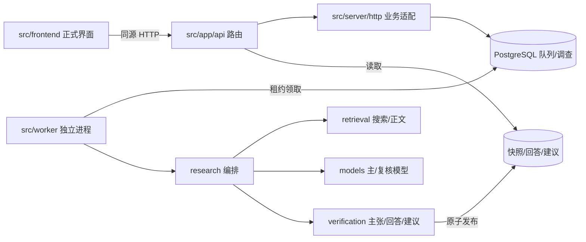

# 工程架构审查报告

审查日期：2026-10-25。范围：当前工作树（基于 `fd55c8e`，未提交改动不覆盖）。方法：实际读取源码/配置/迁移/测试，执行现有验证命令，再做低风险调整并复验。本文只记录可复现的证据；未运行的项目明确标注。

## A. 当前架构评价

**总体健康。** 这是一个规模适中的 Next.js 16 + PostgreSQL/Prisma 7 + 独立 Worker 应用，核心边界已经成立：

- `src/contracts` 是浏览器、Web、Worker 共用的 Zod 契约，未依赖 Next/Prisma。
- HTTP 路由是薄适配层；队列、存储、研究、检索、模型和 Worker 有明确目录。
- 调查/建议队列使用数据库租约、执行令牌、幂等键、完成哈希和原子发布；测试使用独立测试库随机 schema。
- 错误输出有脱敏；本地访问限制、请求体上限、方法白名单和契约校验都在实际路径上。
- 文档、迁移、案例、验收脚本各有归属，根 README 没有堆放实现细节。

最需要改善的不是“缺少抽象”，而是**几个真实边界没有被持续验证**：文档检查曾因机器本地证据链接而失败，前端边界测试指向已改名的目录，演示语料与正式入口打在同一首屏包中，版本库还包含 19.8 MB 的 Windows 专用二进制。本轮已修复这些高价值、低风险问题；剩余债务见 F。

运行链路：



## B. 目录组织审查

### 调整前（关键部分）

```text
.
├── README.md                 启动/验证入口
├── src/
│   ├── app/                  Next 页面与 API 适配
│   ├── frontend/             正式界面 + 演示界面 + 演示语料
│   ├── contracts/            共享契约
│   ├── server/               HTTP/队列/存储/研究/检索/模型/核查
│   ├── worker/               调查与建议 Worker
│   └── generated/            Prisma Client（已忽略）
├── prisma/ migrations/       数据模型与迁移
├── scripts/                  验收、D1、采集、调查工具（无索引）
├── tests/                    单元/集成/夹具/隔离数据库支持
├── cases/                    真实案例与只追加运行记录
├── docs/                     状态、协作、方案、v4 结构、外部参考
│   └── 乙丙_Codex六阶段开发提示词_精简版.md   ← 过期的一次性提示词
├── .agents/                  26 MB 技能资产，含 19.8 MB Windows exe
└── config/ infra/ public/ .github/ ...
```

主要问题：

1. `scripts/` 有 19 个文件，但没有索引；验收脚本、一次性实验和真实采集混在一起，新成员无法判断哪些受支持。
2. 一份已声明“不再限制当前授权范围”的会话提示词仍位于活跃 `docs/` 根目录。
3. 前端 `App.tsx` 同时承载正式入口、演示入口和 300 行演示状态机；`HomeScreen` 又直接依赖 63 KB 演示语料，导致演示内容进入正式首屏。
4. `docs/后端v4结构说明.md` 仍写 `src/components`，与真实 `src/frontend` 不符。
5. `.gitignore` 没有覆盖 `research/`（多个脚本的默认输出）和 `.impeccable/config.local.json`；后者此前只靠本机 `.git/info/exclude`。

### 调整后（关键部分）

```text
.
├── README.md
├── src/
│   ├── app/                  仅根布局、全局样式和 HTTP 路由
│   ├── frontend/
│   │   ├── App.tsx           正式入口；演示模块按需加载
│   │   ├── DemoApp.tsx       演示状态机与演示专用组件
│   │   ├── components/       正式 + 演示共享 UI
│   │   └── data/
│   │       ├── home.ts       正式首页示例/归档占位
│   │       └── scenarios.ts  仅演示语料
│   ├── contracts/ server/ worker/ generated/
├── prisma/ config/ infra/ tests/ cases/
├── scripts/README.md         脚本索引：自动验收 / 人工采集 / 质量实验
├── docs/
│   ├── architecture-review.md
│   └── archive/2026-10-25-Codex六阶段提示词.md
└── .agents/...               二进制已移出版本库，本地文件保留
```

关键调整理由：目录应表达**运行职责**和**证据生命周期**，而不是按扩展名堆放。正式与演示的拆分不是为了多一层目录，而是为了让“演示内容不得混入正式结果”成为可验证的打包边界。

## C. 问题分级与处理

未发现 P0（数据破坏、核心安全边界失效或必然的严重运行故障）。以下按影响排序。

| 级别 | 位置 | 证据 | 影响 | 处理 |
|---|---|---|---|---|
| P1 | `scripts/acceptance/docs.ts`、`cases/*/case.md` | 基线 `npm run docs:check` 失败：25 份文档、26 个断链，全部指向被忽略的 `.cache/d1/network-check-...` | `npm run verify` 与 CI 在最后一步必然失败；机器本地证据被误判为仓库断链 | 已修复：跳过 `.cache/` 目标并计数；同时增加标题锚点校验。复验 0 断链、0 失效锚点、跳过 26 个本地证据 |
| P1 | `tests/unit/source-boundaries.test.ts` | 测试仍检查 `src/components/`，实际目录已是 `src/frontend/` | 前端越界导入服务端/数据库时，该测试会静默放行；ESLint 虽有同类规则，但测试没有形成第二道防线 | 已修复为检查 `src/frontend/`；149 个单元测试通过 |
| P1 | `.agents/skills/impeccable/scripts/bin/windows-x64/impeccable.exe` | 单个 19,796,872 字节 Windows 可执行文件被 Git 跟踪；`.agents` 合计约 26 MB | 克隆体积、跨平台协作和代码审查噪声；与运行时无关 | 已从 Git 索引移除、保留本地工作副本并加入忽略；技能启动器可按其文档在首次运行时重新获取 |
| P1 | `src/frontend/App.tsx`、`data/scenarios.ts`、`HomeScreen.tsx` | 基线首屏 482 KB 分块包含预置案例文本；`App.tsx` 静态导入 `SCENARIOS` 和演示状态机 | 正式首屏携带与当前调查无关的预置答案，增加体积并削弱“只显示真实结果”的边界 | 已拆出 `DemoApp.tsx` 和 `data/home.ts`，用 `next/dynamic` 按需加载；演示语料现在只出现在点击“查看演示样稿”后请求的 139 KB 分块中 |
| P2 | `docs/后端v4结构说明.md` | 写“前端仍位于 `src/app` 与 `src/components`” | 新成员按文档找不到组件；与真实目录冲突 | 已更新为 `src/app` + `src/frontend`，并补充 `app/api` 的适配职责 |
| P2 | `src/app/layout.tsx`、`public/fonts/` | 正式布局请求 Google Fonts；本地 Geist/Noto 字体未被引用；字体说明却写“无网络字体请求” | 离线/内网体验与文档不一致；字体来源事实不清 | 已处理：删除未使用的本地字体与过期说明，README 明确当前 Google Fonts 依赖和离线系统回退 |
| P2 | `src/server/http/api.ts` | `detail`、`identity`、`retry` 直接调用 `tx.job` / `this.db.investigation` | 数据访问没有完全集中在 repository；HTTP 层知道 Prisma 模型细节 | 已处理：`findJob`、`exists` 移入 `InvestigationRepository`，HTTP 不再直接查询 Prisma 模型 |
| P2 | `src/frontend/components/LiveWorkspace.tsx` | 181 行高密度组件，内含轮询、URL 状态、提交、建议和完整报告渲染 | 单文件认知负担高；报告渲染的变更容易触碰控制器逻辑 | 已处理：`Report`/`Section`/`Links` 拆到 `LiveReport.tsx`，标签映射拆到 `lib/live-labels.ts`；控制器只保留轮询、URL、操作锁和表单 |
| P2 | `src/server/research/engine.ts` | 303 行，包含预算、搜索、读取、选段、决策循环和发布前审计 | 不是职责混乱（研究策略集中一处是有意的），但修改面大，测试主要靠替身 | 暂不拆分：拆分需要先固定决策循环的接口；目前没有证据表明拆分能降低真实故障率 |
| P2 | `docs/README.md`、`甲与乙丙协作边界.md`、`乙丙开发与验收方案.md`、`合作者对接与缺失项清单.md` | 状态、分工、任务、缺失项四份文档互有交叉引用 | 读者需要判断“哪份是当前事实”；维护时容易多处同步 | 未合并：四份文档职责不同，且都有活跃链接。已归档纯一次性提示词；后续只允许状态进 `docs/README`、任务进方案 |
| P3 | `src/server/investigation/legacy-v3.ts` | 28 KB 旧引擎，默认不启用，仅 `RESEARCH_ENGINE_VERSION=v3` 切换 | 保留对照有价值，但增加双引擎维护面 | 保留；F 中给出退役条件 |
| P3 | `src/server/investigation/legacy-v3.ts`、`src/server/research/budget.ts` | 两处各自实现 `bounded` 超时竞争 | 语义相近、重复维护 | 保留：v3 是隔离的对照实现，当前合并收益低于回归风险 |
| P3 | `next-env.d.ts` | `next dev` 与 `next build` 会改写 `.next/dev/types` 与 `.next/types` 引用 | 工作树反复出现无意义修改 | 未改：Next 官方要求保留该文件；不要把它当作业务改动提交 |
| P3 | `src/app/layout.tsx` | `themeColor: "#f2eee4"` 与当前 `--color-paper: #f6f7f9` 不一致 | 移动端浏览器栏色差 | 未改：视觉侧改动，需设计确认 |

## D. 实际修改内容

1. **文档检查器** `scripts/acceptance/docs.ts`
   - 跳过 `.cache/` 机器本地证据目标并单独计数，不再把按设计不提交的文件判为断链。
   - 增加 GitHub 风格标题 slug 校验；同一文档重复标题按 `-1` 处理。
   - 输出新增 `brokenAnchors`、`skippedLocalEvidence`。

2. **边界测试** `tests/unit/source-boundaries.test.ts`
   - 将过期的 `src/components/` 检查改为 `src/(components|frontend)/`。

3. **文档整理**
   - `docs/乙丙_Codex六阶段开发提示词_精简版.md` → `docs/archive/2026-10-25-Codex六阶段提示词.md`，补充归档说明并修正相对链接。
   - 修正 `docs/后端v4结构说明.md` 的前端路径与 `src/app` 职责。
   - 新增 `scripts/README.md`，区分自动验收、人工采集、质量实验和输出去向。
   - 更新 `docs/README.md` 的受影响验证计数与当前 `services:check` 事实。

4. **仓库卫生**
   - `.gitignore` 新增 `research/`、`.impeccable/config.local.json`、`.agents/skills/impeccable/scripts/bin/`。
   - 从 Git 索引移除 19.8 MB `impeccable.exe`，本地文件保留；`git status` 中为待提交删除，未执行 commit。

5. **脚本默认值**
   - `scripts/investigation/capture.ts` 默认端口从过期的 3000 改为项目实际的 3405。
   - `scripts/investigation/compare-v4.ts` 不再内置个人 Windows 路径，`--prompts` 改为必填。

6. **前端正式/演示边界**
   - 新增 `src/frontend/DemoApp.tsx`，承载原 `App.tsx` 中的演示状态机。
   - `src/frontend/App.tsx` 只保留正式入口和演示横幅，使用 `next/dynamic` 延迟加载演示模块。
   - 新增 `src/frontend/data/home.ts`，把首页示例与归档占位从 63 KB 演示语料中拆出。
   - `HomeScreen` 不再导入 `SCENARIOS`，`onExample` 改为普通 `string` 签名，正式路径不依赖演示类型。
   - `src/frontend/data/scenarios.ts` 只保留演示场景和 `SCENARIO_LIST`、`DAY_LABEL`。

7. **HTTP 数据访问收口**
   - `InvestigationRepository` 新增 `exists(id)` 与 `findJob(investigationId)`。
   - `src/server/http/api.ts` 的详情、身份确认和重试不再直接访问 `tx.job` / `this.db.investigation`；事务隔离级别和响应契约不变。

8. **正式报告组件拆分**
   - 新增 `src/frontend/components/LiveReport.tsx`，承载 `Section`、`Report`、`Links`。
   - 新增 `src/frontend/lib/live-labels.ts`，集中状态、阶段、主张、核查和关系标签。
   - `LiveWorkspace.tsx` 只保留轮询、URL 状态、提交/建议操作锁和页面骨架；现有 5 条行为测试未改并通过。

9. **打包边界回归断言**
   - `scripts/acceptance/bundles.ts` 读取生产首页 HTML，确认演示标记不在初始分块或内联 HTML 中，并确认演示分块确实已构建。
   - 同一检查增加初始 JS 预算 1,100,000 字节；实测 929,484 字节。
   - 实测输出：`initialDemoChunks: []`、`inlineDemoMarker: false`、`builtDemoChunks: ["1qxz5i38r2yxl.js"]`。

10. **字体单一来源**
    - 删除未被引用的 `public/fonts/`（Geist/Noto woff2、许可证副本、子集说明），保留 `public/favicon.svg`。
    - README 明确当前正文/标题字体由 `src/app/layout.tsx` 的 Google Fonts 提供，离线回退系统字体；不再保留与运行事实冲突的本地字体说明。

11. **仓库大文件守卫**
    - 新增 `scripts/acceptance/hygiene.ts` 与 `npm run hygiene`，检查 Git 跟踪文件中的 exe/dll/压缩包和超过 2 MB 的大文件。
    - 已接入 `npm run verify`；实测 470 个跟踪文件，0 违规。

未改变：公开 HTTP API、Prisma schema、迁移、队列语义、持久化格式、环境变量名、正式页面视觉和演示内容。

## E. 验证结果

执行环境：Windows 11、Node 24.20.0、npm 11.19.0、Docker Compose 本地 PostgreSQL 18.6。数据库容器已启动；测试只写专用测试库随机 schema。

| 检查 | 基线（改动前） | 改动后 |
|---|---|---|
| `npm run typecheck` | 通过 | 通过（Web + Worker） |
| `npm run lint` | 通过 | 通过 |
| `npm test` | 通过：18 文件 / 149 用例 | 通过：18 文件 / 149 用例 |
| `npm run db:test:migrate` | 通过：7 个迁移 | 未重复执行（迁移未改动） |
| `npm run test:db` | 通过：7 文件 / 94 用例 | 通过：7 文件 / 94 用例 |
| `npm run build` | 通过 | 通过 |
| `npm run test:runtime` | 通过：18 项 | 通过：18 项 |
| `npm run audit:bundles` | 通过：12 个客户端产物 | 通过：14 个客户端产物；密钥/服务端运行时/夹具未暴露；`initialDemoChunks: []`、`inlineDemoMarker: false`、演示分块 `1qxz5i38r2yxl.js` 已构建；初始 JS 929,484 / 1,100,000 字节 |
| `npm run docs:check` | **失败：26 个断链** | **通过：25 份活跃文档，0 断链、0 失效锚点，跳过 26 个本地证据** |
| `npm run hygiene` | 不存在 | **通过：470 个跟踪文件，0 个禁止扩展名/大文件** |
| `npm run services:check` | 退出 2（缺 SearchPro/复核模型） | 退出 2（同一环境原因；该命令不在 `verify` 中） |
| `npm run verify` | 会在 docs:check 失败 | **通过：check → test:db → build → test:runtime → audit:bundles → docs:check → hygiene** |

浏览器验证（生产构建 + 无头 Chromium，`next start` 于 `127.0.0.1:3405`）：

- 正式首页渲染成功，标题、示例、归档占位和“查看演示样稿”均可见。
- 点击演示入口后才请求演示分块 `1qxz5i38r2yxl.js`（139,497 字节）；初始 HTML 不包含该分块。演示场景“Devin 官方宣传 vs 实测”可启动并显示过程页。
- 浏览器控制台错误数 0。
- 该验证是 UI/打包 smoke，不是真实 Provider、语义质量或人工验收。

未运行/未能验证：

- `npm audit`：需网络，未执行。
- 托管 GitHub Actions：未运行；本地 `verify` 通过不等于托管 CI 通过。
- 真实 DeepSeek/SearchPro 调用：当前 `.env` 缺 SearchPro 与复核模型配置，未发起网络请求。
- 真实调查/建议端到端：未新增真实 Provider 凭据，未把合成验证说成真实结果。
- `.agents` 删除后的其他电脑技能行为：本机保留二进制，未在无二进制环境复测首次下载。

## F. 剩余技术债务

| 项目 | 原因/风险 | 建议处理时机 |
|---|---|---|
| 字体离线能力 | 已删除未使用的本地资产并明确 Google Fonts 依赖；离线时回退系统字体。若产品要求完全离线，需要重新引入覆盖正文/标题的本地 CJK 字体，成本高于当前清理 | 有明确离线/内网交付要求时再立项，不要恢复只覆盖标题字符的旧子集 |
| `.agents` 仍有约 6 MB 技能文本 | 与运行时无关，且包含多套设计技能；移除二进制已解决最大噪声，但目录仍重 | 若团队不依赖这些技能，整体移出仓库；若依赖，保持“只提交文本、二进制按需下载” |
| 旧 v3 引擎 | 28 KB + 独立测试路径；默认不启用，但仍是维护面 | 当 v4 对照实验结束、无历史复现需求时，删除 `legacy-v3.ts`、`RESEARCH_ENGINE_VERSION` 分支和对应测试；先记录最后一次对照结果 |
| 文档四份并存 | 状态、分工、任务、缺失项各有职责，但交叉引用多 | 保持现有职责；新增内容只进对应文件，不再增加“阶段总结”类文档 |
| `next-env.d.ts` 抖动 | dev/build 交替改写生成引用 | 不纳入提交评审；不要手工编辑 |
| 托管 CI 未核实 | 本地通过 `verify`，但当前工作树未提交/推送 | 提交后立即查看对应 run；若 CI 不通过，先修复环境差异，不引用旧通过 |
| 当前服务配置缺 SearchPro/复核模型 | 代码路径存在，但本机 `.env` 不具备真实调用条件 | 需要真实对照时再补；`services:check` 退出 2 是事实，不是工程回归 |

## G. 后续开发建议

1. **为完全离线场景预留字体决策（按需）。** 当前已删除未使用本地资产并明确 Google Fonts 依赖；若后续出现内网/离线交付要求，再引入覆盖正文和标题的本地 CJK 字体并自行做子集，不要恢复旧标题子集冒充完整字体。

2. **在托管 CI 上执行并固定 `npm run verify`（提交后立即）。** 当前工作树本地通过，但 CI 未运行。把 PostgreSQL service、`db:test:migrate` 和 `verify` 作为必需检查；若 CI 失败，先修环境差异，不用本地通过替代。

3. **维护初始 JS 预算，不要静默放宽。** 当前 `audit:bundles` 已把首屏上限设为 1,100,000 字节（实测 929,484）。新增大型依赖或页面模块时先看该检查的最大分块；确需提高预算时在改动说明中给出理由，避免预算变成形式。

4. **在条件满足时执行 v3 退役。** 退役条件已写入[后端结构说明](后端v4结构说明.md)。下一步是在最近一次同预算对照完成、无未关闭复现项后，删除 `legacy-v3.ts`、`RESEARCH_ENGINE_VERSION` 分支和对应测试，而不是继续双轨维护。

5. **决定 `.agents` 技能资产的归属。** `npm run hygiene` 已阻止 exe/压缩包和 >2 MB 文件再次入库；剩余约 6 MB 设计技能文本仍与产品代码同仓。若团队不再使用这些技能，整体移出；若继续使用，明确“只提交文本、二进制按需下载”的规则。
