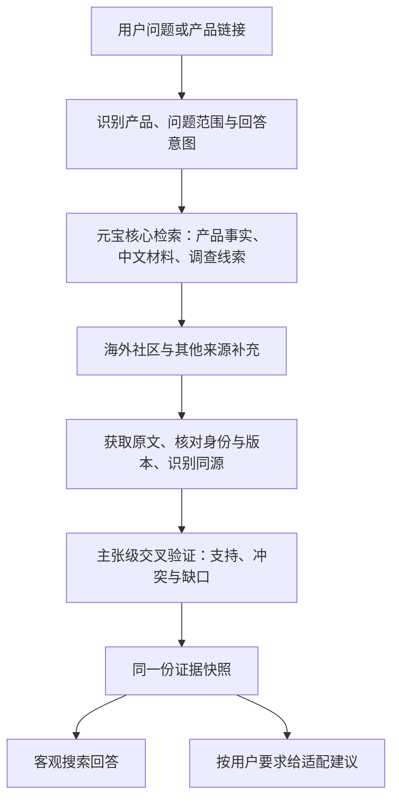

# 案卷｜滚动制作策划书

版本：策划 v2.2 · 2026-10-24 · 当前执行版

## 变更记录

- **v2.2（2026-10-24）**：补齐模块交付接口、D1/D2/D3 负责人／截止／验收、五条红线、六项材料要求及虚构样例；统一检查点并清除旧副本。启动信息待核心填写，未宣称团队已经开工。
- **v2.1（2026-10-24）**：委托改为独立核查与展示口径，页面可选；三份查询改为客观／冲突／建议；海外来源按线索拓展。
- **v2.0（2026-10-24）**：确立客观搜查／适配建议双出口，推荐不再默认输出。

本次修订只调整委托方式和职责：两位队友以独立核查、标注与展示口径为主，页面初步为有余力时的可选交付。具体计划、方法和工具由负责人自主决定。

本版依据你在初版策划后的三项更正：回答形式随问题变化；海外社区是重点证据来源；你主做数据获取与交叉验证核心，队友承担可独立推进的核查和展示工作。制作方式采用边做边验证、边验证边调整。

阅读顺序：先读本书把握方向，再按职责读[核查与交接规范](核查与交接规范.md)、领取[迭代与任务派单](迭代与任务派单.md)。[原产品画像](../资料/原产品画像-v2.txt)作为历史基线；本版明确修改之处以你的最新要求和本版为准。原策划 v1 不再作为派单依据。

## 1. 产品的中心：对一个 AI 产品做有依据的搜查

**用户问一个 AI 产品，案卷帮他把事实、实际使用观点、不同说法和证据缺口查清楚，并按这个问题给出回答。**

目标用户仍以正在学习 AI、需要理解产品的入门者为主。产品应让他看懂“查到了什么、是谁说的、哪些可以核实、哪些仍有争议”。

回答形式分两种，共用一套查证能力：

| 用户的问题 | 应交付的回答 | 用途的处理 |
|---|---|---|
| “帮我搜一下这个产品” | 客观概况、主要功能与限制、定价事实、社区原话、争议和来源 | 直接搜查，不强制追问用途 |
| “搜一下开发者怎么评价它” | 聚焦社区观点及其具体使用场景，正反材料并列 | 可以按“开发者使用”缩小检索范围，不自动变成购买推荐 |
| “免费版支持导出吗” | 回答这个具体事实，附适用套餐、时间和出处 | 不强行生成全套八维评分或推荐档位 |
| “我零基础，想做自动化，每月预算 50 元，适合我吗” | 在相同证据基础上，判断任务能力、门槛和约束，给条件化建议 | 使用用户已给出的要求，不重复盘问 |
| “值得买吗”但没有用途 | 先交已查明事实和关键分歧，再询问影响建议的关键条件 | 只让推荐部分等待条件，已完成的搜查照常展示 |

**是否给出推荐由用户的问题决定，不由页面预设决定。** 用户提到一个用途，也不必然要求推荐；“查编程讨论”与“适合我编程吗”要区分。

## 2. 搜查链路共用，回答随意图组织

这是一个查证核心配两个回答出口。检索词、来源和补查动作由问题需要决定，两个出口不各建一套采集、去重和验证系统。

客观回答可以有事实判断，例如“当前官方定价页列出该套餐包含导出功能”；主观使用评价应写成有出处的观点，例如“这位使用者在大型仓库任务中遇到……”。确认有人发表了一个观点，不等于证明该观点适用于所有人。

适配建议是在证据快照上增加“用户要求 → 相关维度 → 成本和使用条件 → 建议”的解释。原画像的八维和四档用于这类回答；一般搜索不必先通过推荐门槛才交结果。

## 3. 本轮优先级

| 顺序 | 本轮产物 | 验收重点 |
|---|---|---|
| 1 | 一条完整的客观搜查结果 | 输入真实产品，元宝实际参与，原句可核对，页面能打开 |
| 2 | 海外社区观点与中文／官方材料并列 | 看到新增信息价值，区分原话、翻译、转载与独立证据 |
| 3 | 冲突和来源依赖的处理 | 两种说法为什么不同、是否同一版本、是否同一上游 |
| 4 | 按需求推荐 | 仅在用户需要时输出；结论受证据和用户条件约束 |
| 5 | 体验、实用验证与参赛材料 | 用户能用、依据可点、失败可理解、材料真实 |

人工核查与展示口径可以从第一轮并行推进，不必等待核心写完。队友的可选页面 D3 仍按交付卡在主任务验收后启动。

雷达时间线、平台热度、报告美化按余力补齐。它们服务查证结果的理解与发现，不占用原文获取和交叉验证的时间。

## 4. 海外社区是重要调查面

### 4.1 根据线索拓展，不把名单写死

用户已明确 X 重要，其他海外论坛不限定平台。因此本版撤销旧派单中把海外讨论窄化、把 Reddit 永久排除的安排。平台是否进入本次可用版本，由信息价值、可访问原文、接入条件和剩余时间共同决定。

| 来源类型 | 本轮重点 | 提供什么 |
|---|---|---|
| X | 重点探测与接入对象 | 开发者使用片段、首发讨论、问题报告、原作者回应；区分作者身份和商业关系 |
| Hacker News | 优先可核验文本来源 | 具体开发者经历、讨论串、正反论点 |
| GitHub | 项目事实与具体问题来源 | 官方仓库、release、issue、维护者回复、可复现使用问题 |
| 其他海外论坛 | 按产品发现后评估 | Reddit、公开 Discourse、产品论坛等可能相关社区；逐源核查授权、公开性与实际价值 |
| 官方文档／定价／更新记录 | 事实基线 | 当前功能、套餐限制、价格、版本变化；官方性能宣称另作验证 |
| 中文网页、B站等 | 中文体验与事实补充 | 中文用户场景、本地使用门槛、可定位的真实使用材料 |
| YouTube 统计等 | 补充背景 | 真实统计及时间；未获取正文时不当作体验原句 |

“重点来源”表示优先验证它的价值和接入条件，不表示该平台已抓通。每个平台单独说明能发现链接、能取原文、能取统计中的哪些能力。

### 4.2 元宝的关键作用

元宝作为每份新案卷的核心检索步骤，负责产品身份和官方事实线索、中文材料、跨语言查询线索，以及关键争议的补查。平台接口或其他获准方式用于取得和补充社区原文。

元宝无需返回最多材料，但必须实质影响搜查：它发现了哪些页面、确立了哪些产品事实、触发或完成了哪次补查，应能追溯。单纯调用一次再丢弃结果不算核心作用。

对元宝没有命中的海外内容，系统可在确认产品身份后从对应平台补充；不宣称元宝覆盖全部 X 或论坛。新调查如果元宝步骤失败，应明确本次未完成；已有真实快照可带时间继续查看。

### 4.3 海外来源的验收重点

- 记录帖子／评论的直达 URL、原文、作者线索、时间、所属讨论及产品版本。
- 原文与中文翻译分列；模型归纳另列，不能让译文变成“原话”。
- X 发帖、HN 转发和中文转载如果来自同一个作者或实验，保留传播关系，独立证据只计一个源头。
- 一条 GitHub issue 证明“有人报告了某个问题”，不直接证明“所有用户都有这个问题”。维护者回应、关闭原因与修复版本要一起看。
- 海外页面在采集端可读，不代表评委网络可打开。展示原始出处和可定位引用，同时如实标注访问限制；引用快照不能被宣传成原链接已可达。
- 未获 API 权限、读取受限或原文缺失时，保留线索和状态。搜索摘要只能标摘要，不升级成已核验原句。

接入实况由[海外社区接入核查](../资料/海外社区接入核查-2026-10-24.md)补充。文档事实、账号实测和部署实测分别记录，不能互相替代。

## 5. 三人分工：核心、核查、展示

### 5.1 四个模块，各有唯一交付负责人

| 模块 | 主责 | 交给下游的成果 |
|---|---|---|
| M1 数据获取 | 你＋A1 | 元宝及海外等原始材料、来源状态与参与记录 → M2 |
| M2 交叉验证与回答 | 你＋A2 | 支持／冲突／缺口、带引用的双出口结果 → 展示 |
| M3 独立核查与案例标注 | 乙＋Agent | D1 三个真实案例及标注 → 核心与 M4 |
| M4 展示口径与理解验证 | 丙＋Agent | D2 一页口径及两个真实示例 → 核心；D1 独立复核 → 乙 |

完整输入、输出、接收人与责任范围见[模块分工与交付卡](迭代与任务派单.md)。乙负责 D1，丙负责 D2；丙独立复核 D1，乙用 D1 检验 D2。交叉复核不改变唯一负责人，也不转移你的采集、算法与集成责任。

### 5.2 独立工作，交付相接

两位队友可以直接查原文推进，无需等自动采集或算法完成。核查以原始材料为依据，先独立判读再与系统结果对照；展示口径使用真实证据和反例迭代。具体研究方法、工具与内部计划自主。

核心在 T0+2h（绝对时间待填）前提供六个候选产品及问题意图，队友在共同范围内选题。T0、候选、共享目录和群尚待核心补齐，统一登记在派单，不在此重复维护。

### 5.3 页面初步可选，默认不做

D3 由认领者负责，仅在 D1、D2 验收后且有余力时启动，投入不超过 1 小时；T0 晚于 20:00 时取消。交付静态页或样稿，不接接口、不部署。你可用擅长前端的模型支持实际展示与集成；两位队友不默认承担完整前端开发。

## 6. 最小交接面

保持三条交接稳定，细节见[核查与交接规范](核查与交接规范.md)：

1. **数据到核心**：原始材料、发布时间、获取时间、URL、身份／版本线索及源状态。
2. **核心到页面**：问题与回答意图、事实、观点、引用、冲突、缺口、来源覆盖，以及可选的适配建议。
3. **人工核查到核心**：案例 ID、人工判读、原文位置与预期行为；材料按[核查与交接规范](核查与交接规范.md)的“必填 6 项”交接，不要求错误分类。

页面拿到同一种结果对象；没有推荐需求时，推荐字段为空，客观内容照常完整展示。用户增加用途时可基于既有快照生成建议；新增问题超出快照范围时启动补查，生成新快照。

共享字段采用版本标记，先增补兼容字段再迁移使用方。改变字段含义、计数方式或结论语义时，先在本轮检查点通知下游，避免各自运行着不同标准。

## 7. 查证算法的迭代方向

本策划划定算法要解决的问题，不把未经验证的公式写成定案。

| 环节 | 要解决的问题 | 本轮可验收产物 |
|---|---|---|
| 产品与问题识别 | 是否查对产品、版本、套餐与问题范围 | 身份依据与问题范围；歧义时可确认 |
| 多源发现 | 是否找到相关官方事实、实际使用与反面线索 | 查询记录、来源覆盖、失败状态 |
| 原文与主张提取 | 每句话到底在声称什么，谁说的 | 原句、定位、主张类型、上下文 |
| 来源独立性 | 多个平台是否只是复述同一个源头 | 来源分组及可解释的归并原因 |
| 跨源核对 | 支持、反驳是否谈同一件事 | 逐项支持／冲突／缺口与版本条件 |
| 多模型复核 | 是否误读、错引、把宣传当实测 | 独立审查结果、分歧记录与处理 |
| 有限补查 | 继续查什么最能消除决定性分歧 | 补查问题、来源、结果和停止理由 |
| 回答组织 | 哪些内容回答了用户，哪些仍不能决定 | 客观回答，或有条件的适配建议 |

核心可信底线保持稳定：原句能定位、身份与版本不串、转载不冒充独立来源、模型一致不冒充事实证据、来源失败不写成“没有信息”。

可调整的是检索策略、源优先级、独立性识别方法、模型组合、补查预算与推荐规则细节。每次核心调整用相同样本对照前后变化，保留规则／模型／快照版本。

对于新算法或采集方案，先复用已有代码和依赖，再查许可明确、维护活跃的开源设计及一手文献。没有实测的效果写为假设，交由小样本验证。

## 8. 回答与页面怎样制作

### 8.1 客观搜查

针对宽问题，首屏可依次给出：产品是什么、已查明事实、真实使用观点、主要分歧、证据与缺口。针对窄问题，先直接回答该问题，再给必要依据，不把整个案卷强塞到首屏。

用户可以展开官方材料、海外原句与翻译、中文材料和来源状态。每条观点保留作者归属；不把“很多人在 X 上说”作为没有引用的结论。

### 8.2 适配建议

仅当用户提出建议性问题时显示用途判决、相关维度、成本门槛和四档：值得一试／有条件值得／不建议／证据不足。八维表可展开查看，但结论只由本次用途及明确用户条件驱动。

当前沿用[原产品画像](../资料/原产品画像-v2.txt)的推荐门槛作为参考，最新可信度与交接要求见配套规范。以后修改需根据人工样本和真实使用反馈记录，而不是为演示凑结论。

### 8.3 必要状态

检索中、核查中、客观结果完成、部分来源缺失、事实有争议、推荐条件待补充、推荐证据不足、产品身份待确认、元宝失败、复核未完成、历史快照。

“推荐证据不足”不遮住已经核实的价格或原话；“某论坛读取失败”不变成“该论坛没人讨论”。两个模式共用来源卡和引用组件。

## 9. 边做边迭代的工作节奏

### 9.1 五轮可展示成果

| 里程碑 | 团队希望得到的成果 | 核查与标准工作的价值 |
|---|---|---|
| R0 对齐与样例 | 一份共同理解的真实案例 | 有依据的标注和可讨论的展示口径 |
| R1 客观闭环 | 一般产品查询得到可核验结果 | 能指出查错、引错或解释不清的地方 |
| R2 海外与冲突 | 海外原话与不同说法进入真实核查 | 能说明来源关系、翻译与条件差异 |
| R3 按要求建议 | 用户提供要求后得到有依据的建议 | 能检验建议是否符合材料和用户条件 |
| R4 实用与交付 | 可使用、可回溯的正式参赛版本 | 有真实反馈、正式案例和可信度核验 |

这些是团队成果方向，不是个人操作顺序。负责人结合实际进度自行提出本轮可交付范围，已经有价值的成果可以随时交接。

### 9.2 围绕成果对齐

负责人提出本轮目标、可查看产物和预计时间；涉及他人交接或资源需求时对齐。后续安排随发现调整。

交付时说明主要发现和尚未解决的问题即可。你结合真实成果安排下一轮，不要求统一操作清单或固定汇报格式。

### 9.3 比赛时间边界

官方 2026-10-25 12:00 停止组队，16:00 截止提交。团队内部目标为 14:30 前完成首次正式提交，之后验证访问和修阻塞；这是内部安排，不是官方新规定。

从当前可用时间倒排各轮。提交前封存一个可演示、可回溯的版本，后续试验放在另一版本，避免参赛链接随实验失效。可以继续迭代，但正式材料必须对应实际提交版本。

团队检查点（同步[任务派单](迭代与任务派单.md)）：

| 时间（香港时间） | 检查什么 | 本次只问 |
|---|---|---|
| T0+3h（绝对时间待填） | D1 首条；D2 提纲 | 现在能交什么？ |
| T0+6h（绝对时间待填） | D1 三条齐；D2 草稿 | 卡在哪一条证据？ |
| T0+12h（绝对时间待填） | D2 定稿；D1 独立复核完成 | 还有什么没查清？ |
| T0+18h（绝对时间待填） | 三份正式查询成型 | 能否 90 秒演示完？ |
| 2026-10-25 14:30（固定内部目标，T0 偏移待填） | 首次正式提交与访问检查 | 链接能打开吗？ |

排期以[任务派单](迭代与任务派单.md)为准；绝对时间待 T0 确认后填入。若相对排期越过内部目标，核心统一重排，先取消可选页面。T0+6h 为 D1 内容齐备，T0+12h 完成独立复核；T0+3h 为 D2 提纲，T0+6h 为草稿。正式材料均须在内部提交前备齐。

## 10. 验收与参赛材料

产品验收同时覆盖两种回答形式：

- 没给用途的一般产品搜索，能够直接完成，不强制用户填推荐条件。
- 一个明确事实问题，答案含时间、套餐／版本和原句出处。
- 一组海外观点，原文与译文分开，来源可定位，主张的真实性与发表者观点分开。
- 一组冲突材料，能说明冲突点或明确尚不能消除；同源转载不增加独立支持。
- 一次用户补充要求后的建议，复用已有证据或明确补查，不能凭空改变事实。
- 一次缺源或失败，页面与日志反映真实状态。

比赛正式三份查询建议采用：①客观产品搜查，②海外观点与冲突核查，③补充个人要求后的适配建议（可含证据不足和用途变化）。它们展示的是现在的产品核心。核心在 T0+8h（绝对时间待填）前定产品与意图；乙出核查材料，丙出截图／录屏脚本，核心统一录制；T0+18h（绝对时间待填）前完成。90 秒为三份查询的内部快速检查，不替代三分钟路演。

旧画像“三份必须落三个不同分档”在本版改为内部推荐规则测试目标，不再作为全部正式查询的组织要求，因为客观搜查本身没有推荐分档。官方要求仍是三份真实提问材料，含答案、一句话说明和可点击来源。此调整来源于本轮产品方向修订，非官方改规则。

保持至少五位真实目标用户使用并留下匿名查询与反馈记录。由丙招募并记录时间、匿名问题、是否看懂与卡点，乙抽查记录真实性；T0+20h（绝对时间待填）前完成，不采集私人身份和联系方式；三分钟路演用一条客观搜查开始，展示海外原句与争议，再展示用户补充要求后如何形成建议。

侦探赛道奖还需使用元宝搜索，并按官方要求在小红书或视频号分享，带 `#元宝搜索 #WaytoAGI #AI切磋大会 #1024超能Coding周末`。团队成员负责发布与正式提交，Agent 准备材料和检查清单。

## 11. 当前状态与资料依据

本版已完成的是方向修订、职责边界、迭代路线与交接规范。接口可用性、海外原文覆盖、算法效果、网站与试用都以实际交付为准。

比赛依据：[侦探赛道](https://1024.waytoagi.com/tracks/detective)、[官网规则](https://1024.waytoagi.com/rules)。元宝依据：[SearchPro 文档](https://cloud.tencent.com/document/product/1806/121811)、[API KEY 接入](https://cloud.tencent.com/document/product/1806/130615)。既有本地研究可作为接入线索，涉及参数、许可、额度与部署可达性时再次核对当前一手文档与实际环境。

本轮按 ask-matt 的“明确边界 → 形成可执行规格 → 带依赖交接”思路修订已有本地文档；没有创建外部工单、配置新的任务系统或启动产品开发。
