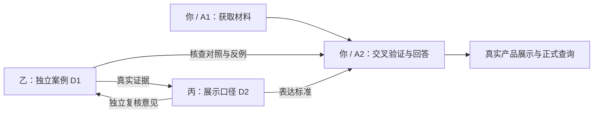

# 案卷｜模块分工与任务交付

版本：v2.2 · 2026-10-24。本文件是交付物、负责人、时间与验收的唯一执行依据；总策划书中的检查点为同步摘录。研究方法、工具和内部工作顺序由执行者自主决定。

## 交付卡

| # | 交付物 | DRI（唯一负责人） | 截止 | 形式 | 验收（三条全过） |
|---|---|---|---|---|---|
| D1 | 客观搜查真实案例 ×3，至少 1 案同时包含海外原句与真实冲突 | 乙 | T0+6h（绝对时间待填）；首条 T0+3h（绝对时间待填）；独立复核 T0+12h（绝对时间待填） | Markdown，一案一章，参考[附录 A](附录A-案例样例.md) | ① 每条结论可定位原句 ② 支持、冲突、缺口可见 ③ 丙完成脱离乙结论的独立复核，并保留意见 |
| D2 | 展示口径 1 页 + 2 个真实示例（客观／适配各一） | 丙 | T0+12h（绝对时间待填）；提纲 T0+3h、草稿 T0+6h（绝对时间均待填） | 1 页 Markdown + 2 张示例卡，参考[附录 B](附录B-口径样例.md) | ① 原话、译文、归纳可区分 ② 读者能说出缺口 ③ 双出口区别可见，且经乙用真实 D1 案例检验 |
| D3 | 页面初步（可选，默认不做） | 认领者；未认领则不启动 | T0+16h（绝对时间待填） | 静态页或样稿 | ① D1、D2 已验收且投入 ≤1 小时 ② 能打开并区分真实材料与演示内容 ③ 仅展示样稿，不接接口、不部署 |

核心验收 D1、D2；D1 的证据争议保留原文和双方意见，不以核心拍板替代事实核查。D3 认领时写明唯一负责人。若 T0 晚于 20:00，D3 取消。

## 模块化分工：各自交什么，交给谁

| 模块 | 负责人 | 收到的输入 | 交出的成果与接收人 | 责任范围 |
|---|---|---|---|---|
| M1 数据获取 | 你＋Agent A1 | 产品、问题、M2 补查需求 | 原文、链接、时间／版本、来源读取状态和元宝参与记录 → M2；可供 M3 定位的线索 | 元宝主检索、海外社区与其他来源获取；保证材料和状态真实 |
| M2 交叉验证与回答核心 | 你＋Agent A2 | M1 材料、用户问题；M3 核查案例；M4 表达口径 | 支持／冲突／缺口及带引用的客观回答或适配建议 → 展示；对照案例后的修正结果 → M3/M4 | 来源独立性、多模型审查、冲突补查、算法实现、结果组织 |
| M3 独立核查与案例标注 | 乙＋Agent | 共同候选范围、用户问题、原始来源线索；系统结果在独立判读后用于对照 | D1 三案、原文依据、主张关系、复核意见 → 核心与 M4 | 独立判断是否查对、引对、说对；不承担采集系统或算法实现 |
| M4 展示口径与理解验证 | 丙＋Agent | D1 真实材料、双出口原则、系统结果 | D2 一页口径与两张真实示例卡 → 核心；D1 独立复核意见 → 乙 | 让用户分清事实、宣称、观点、归纳及未知；不承担完整前端和部署 |

这是交付接口，不限定内部实现。M3/M4 可以直接查原始来源推进，不必等待 M1/M2 跑通；拿不到原文时如实保留缺口。你保留核心和集成责任，可调用擅长前端的其他模型支援。两位队友的必交成果始终是 D1、D2。

## 启动信息：核心补齐，队友提前知晓

| 信息 | 当前状态 | 谁提供／何时 |
|---|---|---|
| T0＝团队收到本包的时间（Asia/Hong_Kong） | 待核心填写，不把文档修改时间当 T0 | 核心在启动时确认，并填绝对截止时间 |
| 6 个候选产品与拟查问题 | 待核心提供；不由本包虚构产品名单 | 核心 T0+2h（绝对时间待填）前提供 |
| 每个候选的回答意图 | 与候选一起提供：客观搜查／适配建议；“冲突核查”是问题类型，归入客观搜查 | 核心随候选提供 |
| 共享目录与一个沟通群 | 待核心填写 | 核心在启动时公布；交付位置以此为准 |

收到候选后，乙在 6 个候选内选择 3 个真实问题，可用同一产品的不同问题；丙可复用同一产品制作两类回答。候选未到时可读资料、试查原文、准备样例形状；范围缺失按阻塞反馈，不把试查自动计入正式三案。

相对时间是本轮默认排期，2026-10-25 14:30 是内部首次提交目标，16:00 是既有官方资料记录的提交截止。T0 未知，不能声称排期已与硬截止对齐；启动时若 T0+18h 或 T0+20h 越过内部目标，由核心统一压缩并更新本文件，再同步总策划书；优先取消 D3。不擅自顺延比赛截止，不为赶时间伪造案例或用户。

## 两位队友的任务说明

### D1：乙负责真实案例，丙独立复核

三案按[必填 6 项](核查与交接规范.md)交接，示例见[附录 A](附录A-案例样例.md)。乙对材料、主张关系与交付完整性负责。丙只看问题和原始材料，先不看乙的结论，独立判读后在案例末尾记录核查人、时间、同意或分歧及依据。乙保留复核意见并修订，尚未解决的分歧列入缺口。

至少一案须有海外原句与真实冲突；若实际找不到，交已取得材料并明确报告该验收项未完成。附录 A 是虚构形状，不能计入 D1。

### D2：丙负责口径，乙用真实案例检验

一页说明怎样区分事实、官方宣称、使用者观点、归纳，以及原文和译文，配同一产品的客观搜查与适配建议真实示例。适配示例中的用户条件应来自真实问题，不补造用户预算或用途。乙用 D1 材料检验能否套用，不适用时带着具体反例退回丙。丙提交修订口径及尚存问题，核心验收。参考[附录 B](附录B-口径样例.md)，附录本身不计入真实示例。

### D3：有余力时认领

只在 D1、D2 验收后启动，最多投入 1 小时。若 T0 晚于 20:00 则取消。样稿选型与做法由认领者决定；它不转移产品核心、集成和部署责任。

## 检查点与沟通

| 时间（香港时间） | 检查什么 | 本次只问 |
|---|---|---|
| T0+3h（绝对时间待填） | D1 首条；D2 提纲 | 现在能交什么？ |
| T0+6h（绝对时间待填） | D1 三条齐；D2 草稿 | 卡在哪一条证据？ |
| T0+12h（绝对时间待填） | D2 定稿；D1 独立复核完成 | 还有什么没查清？ |
| T0+18h（绝对时间待填） | 三份正式查询成型 | 能否 90 秒演示完？ |
| 2026-10-25 14:30（固定内部目标，T0 偏移待填） | 首次正式提交与访问检查 | 链接能打开吗？ |

渠道为一个群与一个共享目录，待核心确认。影响他人交付的阻塞在群里提出，30 分钟内回应；不阻塞的问题进入待议清单。产品方向与合并由核心拍板；核查口径分歧由提出者附方案，核心在提出后 10 分钟内裁决采用口径，证据尚有冲突则继续显式保留。

T0+6h 是 D1 内容齐备，T0+12h 才是独立复核与最终验收。T0+3h 的 D2 是提纲，T0+6h 才是草稿，避免同一版本有两种截止。除交付卡与检查点外，不要求逐步汇报或逐项请示。

## 正式材料的责任人

- 三份真实查询：核心 T0+8h（绝对时间待填）前定产品与意图；乙交核查材料，丙交截图／录屏脚本，核心统一录制；T0+18h（绝对时间待填）完成。90 秒是这组三查询的内部快速演示检查，三分钟路演仍按策划准备。
- 至少五名真实目标用户：丙负责招募和记录时间、匿名问题、是否看懂与卡点；乙抽查记录真实性；T0+20h（绝对时间待填）前完成。只记录必要匿名反馈，不收集联系方式或私人身份资料。
- 公开分享、账号操作与正式提交由核心组织人类成员完成；本包不授权 Agent 对外发布。

## 怎么算做完

D1：三条真实案例按六项交接齐全，独立复核已记录；一个没参与的人能从原文复述“谁说了什么、哪里冲突、还缺什么”。

D2：一个没参与的人看口径及示例 3 分钟，能分清原话／译文／归纳、指出缺口，并区分客观结果与按需求建议；乙的真实案例反例已处理或明确保留。

D3：符合交付卡三条条件，能打开；演示内容明确标注。没有认领或触发取消，不算主任务欠交。

## 交接资料

入口见[开始这里](../开始这里.md)，可信度要求见[核查与交接规范](核查与交接规范.md)。完整前端收藏与工程 AGENTS.md 已随包交付；它们是可用资源，不增加必交任务。后续通过真实案例迭代本文件，不扩大本轮工作量。
