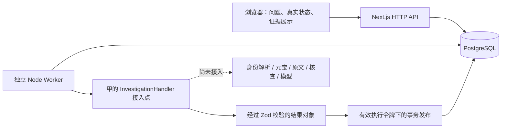

# 公共工程系统架构

本工程的交付范围是可靠执行与可追溯数据的公共底座，不包括真实搜索、原文采集或事实核查算法。真实业务入口当前明确返回 PROVIDER_NOT_CONFIGURED。接入职责见 [三人职责分工与协作边界](三人职责分工与协作边界.md)。

## 运行单元

- **Web**：Next.js App Router、Node Route Handlers、React 页面和 CSS Modules。只读写数据库、创建任务和处理用户控制，不执行长时间外部调用。
- **Worker**：独立 Node 24 进程，轮询领取、维持心跳、执行 handler、处理截止时间与关闭信号。不能导入 Next 请求运行时。
- **数据库**：PostgreSQL 18，持久化任务、执行历史、不可变快照和回答；同时承担队列，不使用 Redis。

三者各自启动。Worker 离线时 API 仍能入队和查询；任务不会显示虚构进度。数据库断线时 Web 返回统一错误，Worker 停止本次写入并继续轮询；恢复后的过期任务按租约回收。

## 模块与依赖

| 目录 | 职责 |
|---|---|
| src/contracts | Zod Schema、推导类型、引用完整性校验；浏览器和 Node 共用，无数据库或 Next 依赖 |
| src/server/http | 输入、状态读取、错误响应与队列控制适配 |
| src/server/queue | 原子入队、SKIP LOCKED、执行令牌、心跳、回收、重试和最终发布 |
| src/server/storage | Prisma Client、JSONB 读写校验、快照／回答引用检查 |
| src/server/investigation | 甲接入的正式编排函数和 context 类型 |
| src/server/identity / retrieval / verification / models | 真实业务服务的接口和明确不可用的默认实现 |
| src/server/recommendation | Advice 接口，尚无生成实现 |
| src/worker | 进程生命周期与执行循环，独立于 Web |
| src/components/investigation | 通过 HTTP 访问数据，禁止导入服务端或 Prisma |

ESLint 与源码边界测试共同限制依赖方向，包括动态字面量 import。生产源码不得导入 tests；测试处理器仅验证基础设施。最终构建还扫描客户端静态资源，确认未包含当前已配置的服务端敏感值、数据库运行时或夹具导入。

## 持久化

六张关系表：Investigation、Job、ExecutionAttempt、EvidenceSnapshot、Answer、Advice。Evidence、Claim、关系、冲突、缺口和检索记录整体存于快照 JSONB；不逐项建表。

一项调查当前只有一个 Job。任务每次领取生成新 executionToken 和尝试记录，外部调用在事务外。结果提交事务先锁 Job，最后用数据库时间和 token 再次条件更新；过期则整笔回滚。详细语义见 [异步任务队列与租约恢复机制](异步任务队列与租约恢复机制.md)。

快照以调查内版本号唯一，后续版本指向同一调查的前一版。数据库 UPDATE/DELETE 触发器拒绝普通覆盖；新版本只能 INSERT。补查任务尚未实现，不能把数据库支持版本链描述为补查能力已经可用。

## 校验与信任边界

1. HTTP 输入校验、32 KiB 请求体限制、幂等键检查。
2. 甲在提供方原始响应与模型输出进入公共对象前做 Zod 校验。
3. Worker 重新校验 handler 输出。
4. Repository 写前校验、读后重新校验，并检查 JSONB 与关系列一致。
5. 新回答引用须指向本快照中存在且已读取的证据，quotes.originalExcerpt 必须逐字符等于已保存原句；错误会使发布回滚。
6. 浏览器响应再校验，所有正文作为文本展示，外链仅 HTTP(S)。

引用相等校验不是语义事实核查：原句本身是否真实、是否能支持该主张、同源判定和翻译准确性仍由甲及独立人工复核负责。数据库不会执行 Zod；具备数据库写权限的代码必须使用公共存储／发布入口，不得以管理员 SQL 绕过校验。

## 当前部署边界

仅支持本地开发。Web 和容器端口绑定回环地址，API 检查本地 Host 与同源 Origin。未实现认证、权限与限流，不直接公开部署付费搜索入口。密钥只在服务端环境中读取；不写入 generationConfig、快照、浏览器代码或仓库。

配置、完整启动和验收入口见 [README](../README.md)。
